<!-- Every card is an animated SVG drawn by scripts/render_cards.py and refreshed daily by
     .github/workflows/refresh-profile.yml. Spacing is baked into the SVGs, so keep this block
     free of blank lines and keep each row of cards on one line with no spaces between  them. -->

 
 
 
 
<picture><source media="(prefers-color-scheme: dark)" srcset="./cards/title-dark.svg" /></picture> 

<h3 align="center">
<a href="https://sunil-s-portfolio.vercel.app/">🌐 See my portfolio: sunil-s-portfolio.vercel.app ↗</a>
</h3>

<a href="https://sunil-s-portfolio.vercel.app/">portfolio</a> &nbsp;/&nbsp; <a href="https://www.linkedin.com/in/sunil-dondey-b8990518b/">linkedin</a> &nbsp;/&nbsp; <a href="https://www.instagram.com/_prince__sunil__/">instagram</a>

